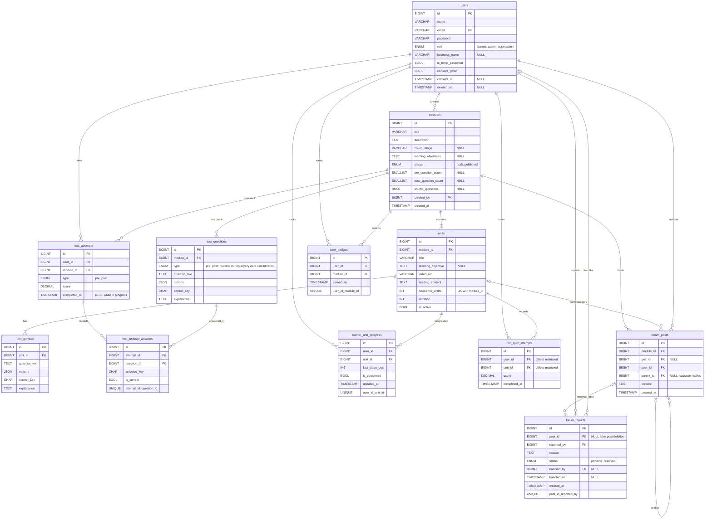

# Keputusan Data dan Kesesuaian ERD

Dokumen ini mencatat audit migration saat ini terhadap [PRD](./PRD.md) bagian 7.4, [ERD](./ERD.md), dan constraint NFR-08. Migration additive yang direncanakan/dibuat tidak dijalankan.

## 1. Audit Catatan PRD 7.4

| No. | Temuan | Status pada migration lama | Keputusan dan tindak lanjut |
|---:|---|---|---|
| 1 | Jenis soal pre/post tidak tersedia pada `test_questions` (FR-A05). | Belum tercakup. Database masih kosong. | Tambahkan `type` wajib dengan nilai `pre` atau `post`. Karena belum ada data lama, tidak diperlukan pemetaan atau backfill. Semua soal yang dibuat setelah migration harus menetapkan jenisnya. |
| 2 | Jawaban per soal tidak tersimpan (FR-L21, FR-L22). | Belum tercakup. | Tambahkan `test_attempt_answers` dengan `attempt_id`, `question_id`, `selected_key`, dan `is_correct`. `test_attempts.completed_at = NULL` tetap berarti pengerjaan masih berlangsung. |
| 3 | Nama usaha tidak tersedia pada `users` (FR-L01, FR-L05). | Belum tercakup. | Tambahkan `business_name` nullable. |
| 4 | Metadata sampul/tujuan/jumlah soal/acak pada modul serta tujuan unit tidak tersedia (FR-A02, FR-A03, FR-A05). | Belum tercakup. | Tambahkan `cover_image`, `learning_objectives`, `pre_question_count`, `post_question_count`, dan `shuffle_questions` ke `modules`, serta `learning_objective` ke `units`. Nilai nullable untuk menjaga kompatibilitas rekaman lama; validasi aplikasi harus mewajibkan konfigurasi yang diperlukan sebelum publikasi/penggunaan tes. |
| 5 | Hasil kuis unit tidak tersimpan (FR-L30). | Belum tercakup. | Dipilih opsi **(b)**: tambah `unit_quiz_attempts`, satu baris per pengerjaan Learner/unit, dengan skor dan waktu penyelesaian. Kuis unit tetap tidak menambah skor pre/post. |
| 6 | Soft delete akun tidak menghapus data pribadi dan konten forum (FR-L06, NFR-06). | Belum tercakup oleh skema saja. `users` sudah memiliki `deleted_at`; foreign key forum masih menunjuk pengguna. | Saat Learner menghapus akun, anonimisasi identitas akun dan konten forum (nama/isi) dalam satu operasi; pertahankan catatan pembelajaran yang diperlukan tanpa identitas personal. Soft-delete menonaktifkan akun. Jangan hard-delete baris pengguna karena relasi historis harus tetap valid. |
| 7 | Persetujuan hanya berupa `consent_given`, tanpa waktu persetujuan. | Belum tercakup. | Tambahkan `consent_at` nullable. Atur nilainya saat persetujuan diberikan; `consent_given` tetap dipertahankan untuk kompatibilitas. |
| 8 | Laporan tidak mencatat penangan, dan perilaku penghapusan topik tidak lengkap. | Belum tercakup. | Tambahkan `handled_by` dan `handled_at`; pertahankan laporan setelah posting dihapus dengan `post_id` nullable. Hapus topik harus menghapus seluruh balasan turunannya. Sebelum penghapusan, tandai semua laporan terkait (termasuk laporan balasan) `resolved` dan catat penangan/waktu secara transaksional. |
| 9 | Pemicu forum tidak konsisten antar dokumen. | Tidak memerlukan perubahan skema; `test_attempts.completed_at` sudah tersedia. | Forum terbuka hanya setelah pre-test modul selesai (`completed_at` terisi), sesuai FR-L31 dan AC-32. Memulai tes saja tidak cukup. |
| 10 | Daftar role pada deskripsi ERD terpotong. | Tiga role sudah ada pada migration lama, tetapi nilainya memakai kapitalisasi `Learner`, `Admin`, `Superadmin`. | Tetapkan nilai skema `learner`, `admin`, `superadmin` sebagaimana rekomendasi PRD; migration baru mengubah nilai yang sudah ada secara terpetakan. Role tetap ditentukan backend, bukan dari input registrasi umum. |
| 11 | Batas 3–5 kuis per unit tidak dijamin oleh basis data. | Belum tercakup oleh constraint DB. | Tegakkan di server saat unit diterbitkan (FR-A11/AB-04); tolak penerbitan bila jumlah bukan 3–5. Ini aturan lintas-baris dan tidak ditambahkan sebagai constraint migration. |
| 12 | Materi unit hanya berupa teks biasa dan belum mendukung penyusunan visual atau impor dokumen (FR-A16). | `units.reading_content` bertipe `TEXT`; tidak ada metadata gambar atau dokumen impor. | Ganti label menjadi **Materi singkat** dan simpan konten sebagai HTML terbatas yang disanitasi pada `units.reading_content` (tanpa perubahan skema). Editor mendukung paragraf, judul, bold, miring, daftar, serta maksimal 10 gambar JPG/JPEG/PNG masing-masing maksimal 5 MB. Simpan gambar privat dengan nama acak dan sajikan melalui endpoint terkontrol; semua Admin dapat mengakses gambar unit melalui panel, sedangkan Learner hanya gambar dari modul terbit; hapus aset unit yang tidak lagi dipakai setelah perubahan konten berhasil atau unit dihapus. Impor DOCX dan PDF maksimal 10 MB; PDF maksimal 50 halaman. Pertahankan format dasar dan ekstrak gambar JPG/JPEG/PNG pada DOCX, dengan batas gambar yang sama. Ekstrak teks PDF digital di browser. DOC lama dan PDF scan/tanpa teks belum didukung; tidak ada OCR. Berkas sumber diproses di browser dan tidak disimpan. Bila format tidak didukung atau ekstraksi gagal, berikan pesan Indonesia dan biarkan editor manual terbuka tanpa mengganti materi yang sudah ada. Gunakan komponen/pustaka tanpa biaya lisensi sesuai NFR-17. |

## 2. Pemeriksaan Constraint NFR-08

| Constraint | Hasil pemeriksaan | Tindak lanjut |
|---|---|---|
| Unik `users.email` | Sudah tercakup oleh `unique()` pada migration users. | Tidak diubah. |
| Unik `(module_id, sequence_order)` pada `units` | Belum tercakup. | Tambahkan unique composite index. |
| Unik `(user_id, unit_id)` pada `learner_unit_progress` | Sudah tercakup. | Tidak diubah. |
| Unik `(user_id, module_id)` pada `user_badges` | Sudah tercakup. | Tidak diubah. |
| Unik `(post_id, reported_by)` pada `forum_reports` (EC-11) | Belum tercakup. | Tambahkan unique composite index agar satu Learner hanya dapat melaporkan posting yang sama sekali. |

Migration untuk unique index dapat gagal jika basis data yang sudah terisi memiliki duplikasi. Periksa dan selesaikan duplikasi sebelum menjalankan migration; migration tidak dijalankan sebagai bagian dari tugas ini.

## 3. Kesesuaian ERD dan Model yang Sudah Ada

- Tabel inti yang sudah ada pada ERD juga sudah memiliki migration: `users`, `modules`, `units`, `unit_quizzes`, `test_questions`, `test_attempts`, `learner_unit_progress`, `user_badges`, `forum_posts`, dan `forum_reports`.
- Tipe `users.name` pada ERD ditulis `VARCHAR(100)`, sedangkan migration Laravel memakai panjang string default (255). Tidak ada aturan panjang nama pada PRD; perubahan batas tidak dibuat.
- Migration users sudah memuat soft delete, hash password melalui cast `hashed` di `User`, `is_temp_password`, dan `consent_given`. Model `User` belum memiliki `business_name` atau `consent_at`; penambahan properti fillable/cast menjadi pekerjaan implementasi aplikasi, bukan bagian perubahan skema ini.
- Migration awal menghapus balasan secara `SET NULL` saat parent dihapus dan menghapus laporan saat posting dihapus. Migration additive mengubah parent ke cascade dan laporan ke `SET NULL` agar kebijakan EC-12 dapat diterapkan tanpa kehilangan jejak laporan.
- Unit yang tidak lagi digunakan dinonaktifkan melalui `units.is_active = false`; kuis dan riwayat pengerjaannya tetap disimpan. Unit nonaktif tidak ditawarkan untuk pembelajaran baru. Unit dengan riwayat kuis tidak boleh dihapus fisik; modul yang memuat riwayat tetap dipertahankan (misalnya dikembalikan ke draft) agar FK `RESTRICT` melindungi data.
- Perubahan role melalui halaman khusus Superadmin diperbolehkan. Frontend dapat mengirim role tujuan pada operasi itu; backend wajib mengautentikasi dan mengotorisasi Superadmin serta memvalidasi role yang diizinkan. Larangan role dari klien tetap berlaku untuk registrasi dan perubahan profil mandiri.

## 4. Keputusan Edge Case bertanda “Perlu keputusan”

### EC-12 — Hapus topik dengan balasan dan laporan

Hapus topik menghapus seluruh balasannya. Laporan yang terkait dengan topik maupun balasan **tidak dihapus**: tandai `resolved`, simpan `handled_by` dan `handled_at`, lalu hapus topik dan balasannya dalam satu transaksi. `forum_reports.post_id` menjadi nullable dengan `ON DELETE SET NULL` agar jejak laporan tetap ada. Hanya Admin yang dapat menjalankan tindakan ini.

### EC-22 — Hapus modul yang sudah memiliki riwayat tes

Tolak penghapusan modul jika terdapat riwayat tes (`test_attempts`) untuk modul tersebut. Tampilkan pesan agar Admin mengembalikan modul ke status draft; status draft menghilangkan modul dari daftar Learner tanpa menghapus riwayat.

## 5. Pertanyaan Terbuka

Tidak ada. Database kosong, sehingga seluruh keputusan yang diminta pada PRD 7.4 dan EC bertanda “Perlu keputusan” sudah dapat ditetapkan.

## 6. Materi Singkat dan Impor Dokumen

- Tautan unit dapat berupa URL YouTube yang valid (`youtube.com/watch`, `youtu.be`, `shorts`, atau `embed`) atau URL file video langsung. Pemutar Admin dan Learner menggunakan embed YouTube hanya dari ID yang diekstrak dan divalidasi server; URL YouTube asli tidak dipakai langsung sebagai `iframe src`. Video privat atau yang melarang embedding dapat gagal diputar dan harus diganti dengan sumber yang mendukung embed.
- `units.reading_content` tetap menjadi kolom penyimpanan; nama label antarmuka adalah **Materi singkat**. Nilainya adalah HTML terbatas, bukan HTML bebas.
- HTML hasil editor atau impor disanitasi di server. Elemen yang diizinkan: paragraf, judul, bold, miring, daftar, dan gambar. Script, atribut event, serta elemen atau atribut aktif lain ditolak/dihapus.
- Gambar yang ditambahkan editor atau diekstrak dari DOCX disimpan secara privat dengan nama acak dan referensi endpoint terkontrol pada HTML. Endpoint hanya mengizinkan Admin atau Learner yang mengakses modul terbit. Maksimal 10 gambar per unit, JPG/JPEG/PNG, maksimal 5 MB per gambar. Hapus gambar milik unit yang sudah tidak direferensikan hanya setelah penyimpanan materi berhasil; hapus seluruh gambar milik unit ketika unit dihapus.
- DOCX dan PDF maksimal 10 MB; PDF maksimal 50 halaman. Pustaka open-source memproses dokumen di browser tanpa mengunggah berkas sumber. Pertahankan paragraf, judul, bold, miring, daftar, dan gambar DOCX bila tersedia. PDF digital diekstrak sebagai teks; DOC lama dan PDF scan/tanpa teks belum didukung dan tidak menggunakan OCR.
- Hasil impor ditampilkan di editor untuk ditinjau dan diedit sebelum penyimpanan. Bila format tidak didukung atau ekstraksi gagal, tampilkan pesan ramah dan biarkan editor manual tersedia; kegagalan tidak boleh menimpa isi materi yang tersimpan.

## 7. ERD Final

