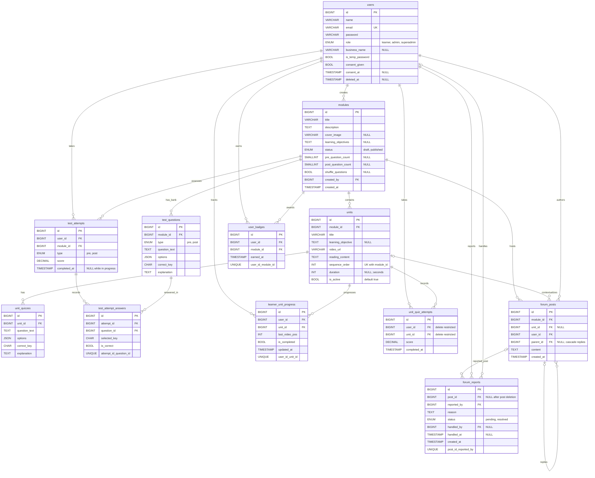

# Keputusan Data dan Kesesuaian ERD

Dokumen ini mencatat keputusan final untuk [PRD](./PRD.md) bagian 7.4, [ERD](./ERD.md), dan constraint NFR-08, serta membedakan keputusan produk dari implementasi. Migration additive tercatat pada repository dan telah dijalankan pada database development ketika diminta; status migration pada environment lain tidak diasumsikan dan perlu diperiksa di environment tersebut. Tidak ada migration yang dijalankan dalam audit dokumentasi ini.

## 1. Audit Catatan PRD 7.4

| No. | Temuan | Kondisi pada skema dan kode saat ini | Keputusan dan tindak lanjut |
|---:|---|---|---|
| 1 | Jenis soal pre/post tidak tersedia pada `test_questions` (FR-A05). | Sudah tercakup: migration menambahkan `type` enum wajib `pre` atau `post`. | Keputusan selesai. Semua soal harus memiliki jenis; alur Admin menyimpan jenis sesuai tab Pre/Post yang aktif. |
| 2 | Jawaban per soal tidak tersimpan (FR-L21, FR-L22). | Sudah tercakup oleh tabel `test_attempt_answers`. | Tabel menyimpan `attempt_id`, `question_id`, `selected_key`, dan `is_correct`; pasangan attempt/soal unik. `test_attempts.completed_at = NULL` menandakan pengerjaan belum selesai. |
| 3 | Nama usaha tidak tersedia pada `users` (FR-L01, FR-L05). | Sudah tercakup: `business_name` nullable. | Kolom tersedia; pendaftaran dan pengelolaan profil Learner belum menjadi fitur aplikasi saat ini. |
| 4 | Metadata sampul/tujuan/jumlah soal/acak pada modul serta tujuan unit tidak tersedia (FR-A02, FR-A03, FR-A05). | Sudah tercakup oleh kolom nullable di `modules` dan `units`. | `cover_image`, `learning_objectives`, `pre_question_count`, `post_question_count`, `shuffle_questions`, dan `learning_objective` tersedia. Validasi publikasi memeriksa konfigurasi dan ketersediaan bank soal. |
| 5 | Hasil kuis unit tidak tersimpan (FR-L30). | Sudah tercakup oleh `unit_quiz_attempts`. | Dipilih opsi **(b)**: satu catatan per pengerjaan Learner/unit dengan skor dan waktu penyelesaian. Kuis unit tetap tidak menambah skor pre/post. Fitur pengerjaan kuis Learner belum tersedia. |
| 6 | Soft delete akun tidak menghapus data pribadi dan konten forum (FR-L06, NFR-06). | `users` memiliki `deleted_at`; anonimisasi belum diimplementasikan. | Keputusan: saat Learner menghapus akun, anonimisasi identitas Learner dan konten forumnya; pertahankan catatan belajar yang diperlukan tanpa identitas personal. Implementasi membutuhkan alur penghapusan akun yang atomik; fitur tersebut belum tersedia. |
| 7 | Persetujuan hanya berupa `consent_given`, tanpa waktu persetujuan. | Sudah tercakup: `consent_at` nullable ditambahkan. | Isi waktu saat persetujuan diberikan; `consent_given` tetap dipertahankan. Kolom tersedia, tetapi alur persetujuan Learner belum diimplementasikan. |
| 8 | Laporan tidak mencatat penangan, dan perilaku penghapusan topik tidak lengkap. | Sudah tercakup pada skema dan alur moderasi Admin. | `handled_by`, `handled_at`, `post_id` nullable, dan cascade balasan tersedia. Penghapusan topik menutup laporan terkait dan menghapus turunannya secara transaksional. |
| 9 | Pemicu forum tidak konsisten antar dokumen. | Keputusan produk: forum dibuka setelah pre-test modul selesai (`completed_at` terisi). | Memulai tes saja tidak cukup. Endpoint/forum Learner belum tersedia; implementasi akses berdasarkan pre-test masih merupakan pekerjaan berikutnya. |
| 10 | Daftar role pada deskripsi ERD terpotong. | Sudah tercakup: enum `learner`, `admin`, `superadmin`. | Nilai role dinormalisasi oleh migration. Role tetap ditetapkan backend; operasi ubah role khusus Superadmin diizinkan oleh keputusan produk, tetapi UI dan endpoint-nya belum tersedia. |
| 11 | Batas 3–5 kuis per unit tidak dijamin oleh basis data; unit juga perlu status aktif/nonaktif. | Validasi 3–5 berjalan pada server saat modul diterbitkan; `units.is_active` tersedia dengan default `true`. | Validasi lintas-baris tetap di server. Status aktif belum dapat diubah dari UI/route Admin; sampai diimplementasikan, jangan menganggap penonaktifan unit tersedia. |
| 12 | Materi unit hanya berupa teks biasa dan belum mendukung penyusunan visual atau impor dokumen (FR-A16). | `units.reading_content` bertipe `TEXT`; tidak ada metadata gambar atau dokumen impor. | Ganti label menjadi **Materi singkat** dan simpan konten sebagai HTML terbatas yang disanitasi pada `units.reading_content` (tanpa perubahan skema). Editor mendukung paragraf, judul, bold, miring, daftar, serta maksimal 10 gambar JPG/JPEG/PNG masing-masing maksimal 5 MB. Simpan gambar privat dengan nama acak dan sajikan melalui endpoint terkontrol; semua Admin dapat mengakses gambar unit melalui panel, sedangkan Learner hanya gambar dari modul terbit; hapus aset unit yang tidak lagi dipakai setelah perubahan konten berhasil atau unit dihapus. Impor DOCX dan PDF maksimal 10 MB; PDF maksimal 50 halaman. Pertahankan format dasar dan ekstrak gambar JPG/JPEG/PNG pada DOCX, dengan batas gambar yang sama. Ekstrak teks PDF digital di browser. DOC lama dan PDF scan/tanpa teks belum didukung; tidak ada OCR. Berkas sumber diproses di browser dan tidak disimpan. Bila format tidak didukung atau ekstraksi gagal, berikan pesan Indonesia dan biarkan editor manual terbuka tanpa mengganti materi yang sudah ada. Gunakan komponen/pustaka tanpa biaya lisensi sesuai NFR-17. |

## 2. Pemeriksaan Constraint NFR-08

| Constraint | Hasil pemeriksaan | Tindak lanjut |
|---|---|---|
| Unik `users.email` | Sudah tercakup oleh `unique()` pada migration users. | Tidak diubah. |
| Unik `(module_id, sequence_order)` pada `units` | Sudah tercakup oleh unique composite index. | Tidak diubah. |
| Unik `(user_id, unit_id)` pada `learner_unit_progress` | Sudah tercakup. | Tidak diubah. |
| Unik `(user_id, module_id)` pada `user_badges` | Sudah tercakup. | Tidak diubah. |
| Unik `(post_id, reported_by)` pada `forum_reports` (EC-11) | Sudah tercakup oleh unique composite index. | Tidak diubah; satu Learner hanya dapat melaporkan posting yang sama sekali. Setelah posting dihapus, `post_id` menjadi `NULL` sehingga laporan historis tetap tersimpan. |

Constraint tercantum pada migration repository. Sebelum menjalankan migration pada environment baru/berbeda, periksa status dan data environment tersebut; jangan mengasumsikan isinya kosong atau status migration-nya sama dengan database development.

## 3. Kesesuaian ERD dan Model yang Sudah Ada

- Tabel domain pada skema meliputi `users`, `modules`, `units`, `unit_quizzes`, `test_questions`, `test_attempts`, `test_attempt_answers`, `unit_quiz_attempts`, `learner_unit_progress`, `user_badges`, `forum_posts`, dan `forum_reports`.
- Kolom string `users.name` memakai panjang default Laravel (255); ERD menggunakan notasi `VARCHAR` tanpa mengulang panjang default tersebut.
- Migration users memuat soft delete, `is_temp_password`, `consent_given`, `business_name`, dan `consent_at`. Password di-hash oleh model `User`. Kolom data tambahan sudah ada pada skema, tetapi pendaftaran/profil Learner dan alur persetujuan belum menjadi fitur saat ini.
- Migration mengatur cascade untuk balasan forum dan `SET NULL` untuk `forum_reports.post_id`; laporan tetap tersimpan ketika posting dihapus. Fitur moderasi Admin menutup laporan terkait sebelum penghapusan.
- Kolom `units.is_active` ditambahkan dan dipakai oleh rekap untuk menghitung unit aktif. Belum ada route/UI untuk mengubah status unit atau alur Learner yang menyembunyikan unit nonaktif. Unit dengan riwayat kuis tidak dapat dihapus; modul dengan riwayat tes atau kuis juga ditolak dari penghapusan dan disarankan kembali ke draft.
- Perubahan role melalui halaman khusus Superadmin diperbolehkan. Frontend dapat mengirim role tujuan pada operasi itu; backend wajib mengautentikasi dan mengotorisasi Superadmin serta memvalidasi role yang diizinkan. Larangan role dari klien tetap berlaku untuk registrasi dan perubahan profil mandiri.

## 4. Keputusan Edge Case

### EC-12 — Hapus topik dengan balasan dan laporan

Hapus topik menghapus seluruh balasannya. Laporan yang terkait dengan topik maupun balasan **tidak dihapus**: tandai `resolved`, simpan `handled_by` dan `handled_at`, lalu hapus topik dan balasannya dalam satu transaksi. `forum_reports.post_id` menjadi nullable dengan `ON DELETE SET NULL` agar jejak laporan tetap ada. Hanya Admin yang dapat menjalankan tindakan ini.

### EC-22 — Hapus modul yang sudah memiliki riwayat tes

Tolak penghapusan modul jika terdapat riwayat tes (`test_attempts`) untuk modul tersebut. Tampilkan pesan agar Admin mengembalikan modul ke status draft; status draft menghilangkan modul dari daftar Learner tanpa menghapus riwayat.

## 5. Pertanyaan Terbuka

Tidak ada keputusan produk terbuka dari daftar PRD 7.4 dan EC-12/EC-22 yang diminta. Ini tidak menyatakan database suatu environment kosong atau seluruh keputusan sudah diimplementasikan.

## 6. Materi Singkat dan Impor Dokumen

- Tautan unit dapat berupa URL YouTube yang valid (`youtube.com/watch`, `youtu.be`, `shorts`, atau `embed`) atau URL file video langsung. Pemutar Admin dan Learner menggunakan embed YouTube hanya dari ID yang diekstrak dan divalidasi server; URL YouTube asli tidak dipakai langsung sebagai `iframe src`. Video privat atau yang melarang embedding dapat gagal diputar dan harus diganti dengan sumber yang mendukung embed.
- `units.reading_content` tetap menjadi kolom penyimpanan; nama label antarmuka adalah **Materi singkat**. Nilainya adalah HTML terbatas, bukan HTML bebas.
- HTML hasil editor atau impor disanitasi di server. Elemen yang diizinkan: paragraf, judul, bold, miring, daftar, dan gambar. Script, atribut event, serta elemen atau atribut aktif lain ditolak/dihapus.
- Gambar yang ditambahkan editor atau diekstrak dari DOCX disimpan secara privat dengan nama acak dan referensi endpoint terkontrol pada HTML. Endpoint hanya mengizinkan Admin atau Learner yang mengakses modul terbit. Maksimal 10 gambar per unit, JPG/JPEG/PNG, maksimal 5 MB per gambar. Hapus gambar milik unit yang sudah tidak direferensikan hanya setelah penyimpanan materi berhasil; hapus seluruh gambar milik unit ketika unit dihapus.
- DOCX dan PDF maksimal 10 MB; PDF maksimal 50 halaman. Pustaka open-source memproses dokumen di browser tanpa mengunggah berkas sumber. Pertahankan paragraf, judul, bold, miring, daftar, dan gambar DOCX bila tersedia. PDF digital diekstrak sebagai teks; DOC lama dan PDF scan/tanpa teks belum didukung dan tidak menggunakan OCR.
- Hasil impor ditampilkan di editor untuk ditinjau dan diedit sebelum penyimpanan. Bila format tidak didukung atau ekstraksi gagal, tampilkan pesan ramah dan biarkan editor manual tersedia; kegagalan tidak boleh menimpa isi materi yang tersimpan.

## 7. ERD Final

## 8. Rekap

- Skor pre dan post adalah skor dari pengerjaan tes selesai (`completed_at` terisi) yang paling baru per Learner, modul, dan jenis tes. Urutan ditentukan oleh `completed_at`; bila waktunya sama, ID pengerjaan terbesar dianggap terbaru.
- Filter periode menerapkan rentang inklusif pada `completed_at` sebelum memilih pengerjaan terbaru. Baris rekap hanya tampil bila pasangan Learner–modul memiliki setidaknya satu pengerjaan tes selesai dalam filter tersebut.
- Selisih adalah skor post dikurangi skor pre. Skor yang belum tersedia dan selisih yang tidak dapat dihitung ditampilkan sebagai `-`.
- Unit selesai adalah jumlah progres `is_completed = true` pada unit `is_active = true`, dibagi jumlah seluruh unit aktif modul. Modul tanpa unit aktif memiliki pembilang dan penyebut nol.
- Rata-rata dashboard memakai skor pre dan post terbaru yang sama dengan rekap, tanpa filter periode, serta hanya memasukkan Learner yang memiliki kedua skor pada modul tersebut. Learner yang dihapus/anonim tidak dimasukkan.
- CSV mengekspor seluruh baris yang cocok dengan filter, melintasi seluruh halaman. Kolom dan nilai menggunakan susunan dan pemformatan yang sama dengan tabel. Nilai sel yang dimulai `=`, `+`, `-`, atau `@` diawali tanda kutip tunggal dan file memakai UTF-8 BOM.
- Daftar Learner memakai filter rentang tanggal daftar serta pencarian nama/email; akun soft-delete (`deleted_at` terisi) tidak ditampilkan.

## 9. Superadmin

- **Akses dan batas role (FR-SA01–FR-SA07, FR-S05):** Superadmin memakai halaman login panel yang sama dengan Admin, tanpa registrasi. Login mengarah ke `/superadmin/admins`. Route Superadmin hanya untuk role `superadmin`; route Admin tetap khusus role `admin`. Menu tiap role terpisah. Superadmin tidak memperoleh route untuk konten, soal, rekap/skor, atau forum.
- **Akun Superadmin sendiri:** Superadmin tidak dapat menghapus atau mengubah role akunnya sendiri. Tidak ada endpoint untuk membuat atau menetapkan role `superadmin`; API perubahan role hanya menerima `learner` atau `admin`.
- **Tambah Admin (FR-SA02, AC-11):** input hanya nama dan email. Server menetapkan role `admin`, membuat password sementara acak kuat, dan menandai `is_temp_password = true`. Password ditampilkan sekali setelah akun dibuat, tidak dikirim lewat email, tidak disimpan di database dalam bentuk teks, dan tidak ditulis ke log.
- **Ubah role (FR-SA04, FR-SA06, AC-12, EC-18):** perubahan hanya melalui endpoint role khusus. Perubahan role tidak mengubah password atau `is_temp_password`; akun tetap memakai password dan status penggantian password yang sudah dimiliki sebelum perubahan role. Keputusan EC-18 ini sudah dipastikan oleh pemilik kebutuhan dan tidak ambigu.
- **Hapus Admin (AB-12, EC-17, AC-13):** gunakan soft delete, jangan menghapus baris `users`. Konten dan foreign key seperti `modules.created_by` tetap valid. Relasi konten yang menampilkan pembuat harus menyertakan akun soft-deleted dan menandainya sebagai akun dihapus.
- **Hapus Learner (keputusan 6, FR-SA05):** lakukan soft delete serta anonimisasi nama, email, nama usaha, password, consent, dan seluruh isi posting/balasan forum milik Learner dalam satu transaksi. Jangan hard-delete baris `users`; catatan belajar tetap tersimpan dan Superadmin tidak diberi akses kepadanya. Email anonim tetap unik agar alamat lama dapat dipakai kembali.
- **Validasi dan pembatasan target (AB-16, FR-S01):** semua operasi akun memakai Form Request; nama wajib maksimal 100 karakter, email wajib dan valid serta unik, dan role hanya `learner` atau `admin`. Route binding `/superadmin/admins/{user}` hanya menerima akun ber-role Admin dan `/superadmin/learners/{user}` hanya menerima Learner; target role lain menghasilkan 404.
- **Metode dan konfirmasi:** perubahan data memakai PUT, perubahan role memakai PUT pada endpoint khusus, penghapusan memakai DELETE dan CSRF; tidak ada aksi tulis melalui GET. UI meminta konfirmasi sebelum menghapus Learner.
