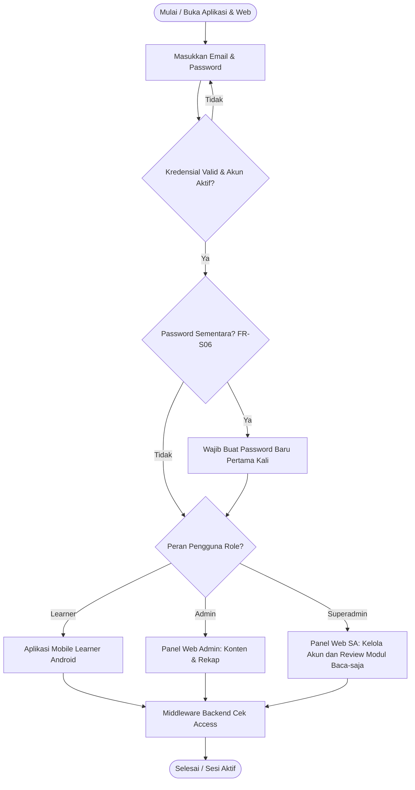
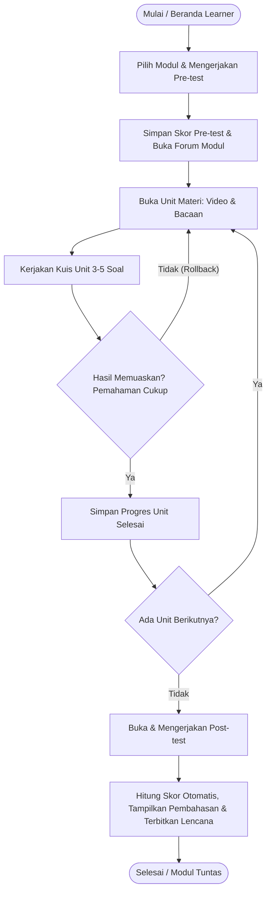
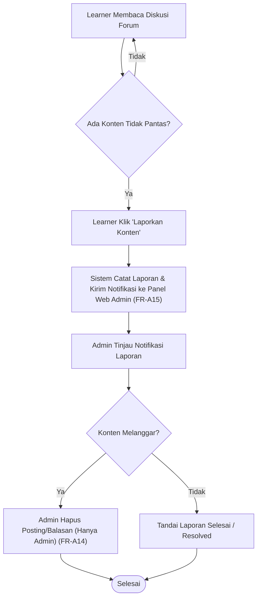
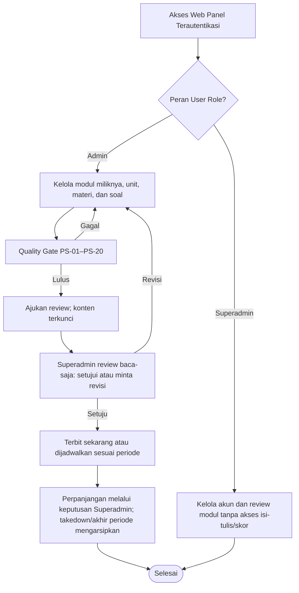

# ERD dan Flowchart — SINAU

Dokumen ini menggambarkan skema domain yang dibentuk migration saat ini sekaligus relasi yang direncanakan untuk produk Sinau. Content Governance panel Admin/Superadmin tersedia; implementasi proses belajar Learner/mobile belum tersedia. Status fitur yang benar-benar berjalan dicatat di [ARCHITECTURE.md](./ARCHITECTURE.md).

> Diagram memakai sintaks [Mermaid](https://mermaid.js.org/). Kolom, tabel, dan constraint di bawah diselaraskan dengan migration saat ini. Status alur produk pada flowchart tetap merupakan target kebutuhan, bukan bukti bahwa seluruh alur sudah diimplementasikan.

## 1. Entity Relationship Diagram (Gambar 1)

```mermaid
erDiagram
    users ||--o{ modules : "created_by (Admin membuat modul)"
    users o|--o{ modules : "approved_by"
    users o|--o{ module_reviews : "actor_id"
    modules ||--o{ module_reviews : "audit history"
    modules ||--o{ module_extension_requests : "extension requests"
    users ||--o{ module_extension_requests : "requested_by"
    users o|--o{ module_extension_requests : "decided_by"
    modules ||--o{ module_reminders : "expiry reminders"
    users ||--o{ notifications : "notifiable"
    modules ||--o{ units : "contains"
    units ||--o{ unit_quizzes : "has quizzes"
    modules ||--o{ test_questions : "bank soal pre/post"
    users ||--o{ test_attempts : "mengerjakan"
    modules ||--o{ test_attempts : "per modul"
    users ||--o{ user_badges : "memperoleh"
    modules ||--o{ user_badges : "per modul"
    modules ||--o{ forum_posts : "forum modul"
    units |o--o{ forum_posts : "unit opsional"
    users ||--o{ forum_posts : "penulis"
    forum_posts |o--o{ forum_posts : "balasan (parent_id)"
    test_attempts ||--o{ test_attempt_answers : "jawaban"
    test_questions ||--o{ test_attempt_answers : "dijawab"
    users ||--o{ learner_unit_progress : "progres"
    units ||--o{ learner_unit_progress : "untuk unit"
    users ||--o{ unit_quiz_attempts : "mengerjakan"
    units ||--o{ unit_quiz_attempts : "riwayat kuis"
    forum_posts o|--o{ forum_reports : "dilaporkan"
    users ||--o{ forum_reports : "reported_by"
    users o|--o{ forum_reports : "handled_by"

    users {
        BIGINT id PK
        VARCHAR name
        VARCHAR email UK
        VARCHAR password
        ENUM role "learner, admin, superadmin"
        VARCHAR business_name "NULL"
        BOOL is_temp_password
        BOOL consent_given
        TIMESTAMP consent_at "NULL"
        TIMESTAMP created_at
        TIMESTAMP deleted_at
    }
    modules {
        BIGINT id PK
        VARCHAR title
        TEXT description
        VARCHAR cover_image "NULL"
        TEXT learning_objectives "NULL"
        ENUM status "draft, submitted, revision_required, approved, published, archived"
        SMALLINT pre_question_count "NULL"
        SMALLINT post_question_count "NULL"
        BOOL shuffle_questions "NULL"
        BIGINT created_by FK
        VARCHAR category "NULL"
        TEXT target_audience "NULL"
        VARCHAR difficulty "NULL"
        DATE active_from "NULL"
        DATE active_until "NULL"
        TIMESTAMP submitted_at "NULL"
        BIGINT approved_by FK "NULL"
        TIMESTAMP approved_at "NULL"
        BIGINT revision_of_id FK "NULL"
        TIMESTAMP created_at
    }
    module_reviews {
        BIGINT id PK
        BIGINT module_id FK
        BIGINT actor_id FK "NULL for system"
        VARCHAR action
        VARCHAR status_from "NULL"
        VARCHAR status_to "NULL"
        TEXT notes "NULL"
        JSON metadata "NULL"
        TIMESTAMP created_at
    }
    module_extension_requests {
        BIGINT id PK
        BIGINT module_id FK
        BIGINT requested_by FK
        DATE previous_active_until
        DATE requested_active_until
        TEXT reason
        ENUM status "pending, approved, rejected"
        BIGINT decided_by FK "NULL"
        TIMESTAMP decided_at "NULL"
        TEXT decision_notes "NULL"
    }
    module_reminders {
        BIGINT id PK
        BIGINT module_id FK
        SMALLINT days_before
        DATE active_until
        TIMESTAMP sent_at
        UNIQUE module_id_days_before_active_until
    }
    notifications {
        UUID id PK
        VARCHAR type
        VARCHAR notifiable_type
        BIGINT notifiable_id
        TEXT data
        TIMESTAMP read_at "NULL"
        TIMESTAMP created_at
        TIMESTAMP updated_at
    }
    units {
        BIGINT id PK
        BIGINT module_id FK
        VARCHAR title
        TEXT learning_objective "NULL"
        VARCHAR video_url
        TEXT reading_content "materi singkat; HTML terbatas tersanitasi"
        INT sequence_order "UK with module_id"
        INT duration "NULL; seconds"
        BOOL is_active
    }
    unit_quizzes {
        BIGINT id PK
        BIGINT unit_id FK
        TEXT question_text
        VARCHAR question_format "multiple_choice, checkbox, true_false"
        JSON options
        JSON correct_keys
        CHAR_1 correct_key "legacy first key"
        TEXT explanation
    }
    test_questions {
        BIGINT id PK
        BIGINT module_id FK
        ENUM type "pre, post"
        TEXT question_text
        VARCHAR question_format "multiple_choice, checkbox, true_false"
        JSON options
        JSON correct_keys
        CHAR_1 correct_key "legacy first key"
        TEXT explanation
    }
    test_attempts {
        BIGINT id PK
        BIGINT user_id FK
        BIGINT module_id FK
        ENUM type "pre, post"
        DECIMAL_5_2 score
        TIMESTAMP completed_at "NULL while unfinished"
    }
    test_attempt_answers {
        BIGINT id PK
        BIGINT attempt_id FK
        BIGINT question_id FK
        CHAR selected_key "legacy first key"
        JSON selected_keys
        BOOL is_correct
        UNIQUE attempt_id_question_id
    }
    learner_unit_progress {
        BIGINT id PK
        BIGINT user_id FK
        BIGINT unit_id FK
        INT last_video_pos
        BOOL is_completed
        TIMESTAMP updated_at
        UNIQUE user_id_unit_id
    }
    unit_quiz_attempts {
        BIGINT id PK
        BIGINT user_id FK "delete restricted"
        BIGINT unit_id FK "delete restricted"
        DECIMAL score
        TIMESTAMP completed_at
    }
    user_badges {
        BIGINT id PK
        BIGINT user_id FK
        BIGINT module_id FK
        TIMESTAMP earned_at
        UNIQUE user_id_module_id
    }
    forum_posts {
        BIGINT id PK
        BIGINT module_id FK
        BIGINT unit_id FK "NULL"
        BIGINT user_id FK
        BIGINT parent_id FK "NULL; cascade replies"
        TEXT content
        TIMESTAMP created_at
    }
    forum_reports {
        BIGINT id PK
        BIGINT post_id FK "NULL on post deletion"
        BIGINT reported_by FK
        TEXT reason
        ENUM status "pending, resolved"
        BIGINT handled_by FK "NULL"
        TIMESTAMP handled_at "NULL"
        TIMESTAMP created_at
        UNIQUE post_id_reported_by
    }
```

Keterangan: PK = Primary Key; FK = Foreign Key; UK = Unique Key. Satu baris `users` mewakili Learner, Admin, atau Superadmin. Batas kuis unit ditetapkan 3–5 soal per unit.

### 1.1 Penjelasan ERD

| Tabel | Fungsi dan Hubungan |
|---|---|
| `users` | Menyimpan akun Learner, Admin, dan Superadmin. `email` unik; `role` bernilai `learner`, `admin`, atau `superadmin`. `is_temp_password` mendukung kewajiban ganti password Admin (FR-S06). `business_name` dan `consent_at` nullable. `deleted_at` mendukung soft delete; kebijakan anonimisasi saat penghapusan akun sudah diputuskan, tetapi belum diimplementasikan. |
| `modules` | Menyimpan metadata, periode aktif, Admin pembuat, approver, dan relasi versi. Status workflow: `draft`, `submitted`, `revision_required`, `approved`, `published`, `archived`. Admin hanya mengubah modul miliknya sesuai status; Superadmin dapat melihat modul baca-saja dan melakukan keputusan governance, bukan menulis konten atau melihat skor. |
| `module_reviews` | Audit trail per modul untuk submission, keputusan review, revisi, takedown, perubahan status terjadwal, perpanjangan, dan perubahan minor/versi; aktor dapat `NULL` untuk proses sistem. |
| `module_extension_requests` | Menyimpan pengajuan perpanjangan Admin dan keputusan Superadmin beserta periode lama/baru, alasan, status, penentu, waktu, dan catatan keputusan. |
| `module_reminders` | Mencegah pengiriman berulang pengingat masa aktif H-14/H-3 dalam periode yang sama. |
| `notifications` | Menyimpan notifikasi in-panel per penerima, termasuk status baca; endpoint hanya mengizinkan penerima melihat atau menandainya terbaca. |
| `units` | Menyimpan unit per modul beserta urutan unik per modul, video, tujuan, materi, durasi, dan `is_active` (default true). `duration` nullable dan disimpan dalam detik; form Admin menerima menit. `reading_content` berisi HTML terbatas yang disanitasi server. Gambar materi disimpan sebagai file privat dan dokumen impor diproses sementara. Kolom `is_active` tersedia, tetapi belum ada UI/route Admin untuk mengubahnya. |
| `unit_quizzes` | Bank soal kuis atau studi kasus khusus tiap unit. Terikat pada `unit_id`. Setiap unit wajib memiliki 3 sampai 5 soal berformat pilihan ganda, checkbox, atau benar/salah beserta kunci dan pembahasan. |
| `test_questions` | Bank soal Pre/Post per modul. Kolom `type` wajib bernilai `pre` atau `post`; `question_format` membedakan pilihan ganda, checkbox, atau benar/salah. `correct_keys` menyimpan semua kunci benar; `correct_key` dipertahankan sebagai kunci pertama untuk kompatibilitas data lama. |
| `test_attempts` | Menyimpan skor dan status pengerjaan Pre/Post. `completed_at` nullable menandakan attempt belum selesai. Jawaban per soal disimpan terpisah. Forum ditetapkan terbuka setelah pre-test selesai, tetapi forum Learner belum diimplementasikan. |
| `test_attempt_answers` | Menyimpan pilihan dan benar/salah tiap soal untuk satu attempt. `selected_keys` menyimpan satu atau beberapa pilihan Learner; `selected_key` dipertahankan sebagai pilihan pertama untuk kompatibilitas. Kombinasi `attempt_id` dan `question_id` unik; relasi ke attempt dan pertanyaan dihapus berantai. |
| `learner_unit_progress` | Mencatat posisi video dan status selesai per Learner/unit. Kombinasi `user_id` dan `unit_id` unik. |
| `unit_quiz_attempts` | Menyimpan skor dan waktu penyelesaian kuis unit. Penghapusan user atau unit dibatasi oleh FK (`RESTRICT`) agar riwayat tidak terhapus. Tabel tersedia, tetapi pengerjaan kuis Learner belum ada. |
| `user_badges` | Menyimpan lencana personal per Learner/modul; pasangan user/modul unik. Tidak ada peringkat antar pengguna. |
| `forum_posts` | Menyimpan topik dan balasan per modul, opsional terkait unit. `parent_id` mendukung balasan bertingkat dan memakai cascade saat parent dihapus. |
| `forum_reports` | Menyimpan laporan dengan status, pelapor, penangan, dan waktu penanganan. `post_id` nullable dan menjadi `NULL` ketika posting dihapus agar jejak laporan terjaga; satu pelapor hanya dapat melaporkan posting yang sama sekali. |

### 1.2 Kardinalitas dan Aturan Integritas

- `users` ke `modules`: 1 : 0..N (Admin dapat membuat banyak modul).
- `modules` ke `module_reviews`, `module_extension_requests`, dan `module_reminders`: 1 : 0..N.
- `modules.revision_of_id` menghubungkan salinan revisi ke versi asal; judul yang sama hanya dibolehkan dalam keluarga versi yang sama.
- `modules` ke `units`: 1 : 1..N (satu modul terdiri atas satu atau lebih unit berurutan).
- `units` ke `unit_quizzes`: 1 : 3..5 (setiap unit wajib memiliki 3 hingga 5 soal kuis/studi kasus).
- `(module_id, sequence_order)` unik pada `units`; `(user_id, unit_id)` unik pada progres; `(user_id, module_id)` unik pada lencana; `(post_id, reported_by)` unik pada laporan.
- Batas kuis 3–5 divalidasi server ketika modul diterbitkan; batas ini tidak dinyatakan sebagai constraint database.
- `modules` ke `forum_posts`: 1 : 0..N (forum dibuka per modul setelah Learner menyelesaikan pre-test).
- `forum_posts` ke `forum_reports`: 1 : 0..N (setiap postingan forum dapat dilaporkan oleh beberapa Learner).
- `forum_posts.parent_id` menghapus balasan turunan secara cascade; `forum_reports.post_id` menjadi `NULL` ketika posting dihapus.
- **Hak akses data:** skor `test_attempts` hanya dapat diakses Learner pemilik dan Admin; Superadmin tidak memperoleh akses ke tabel attempt/skor, rekap, atau forum. Middleware membatasi Admin pada modul miliknya dan memberi Superadmin route baca-saja untuk review serta endpoint keputusan terpisah.

---

## 2. Flowchart

> Flowchart 2.1–2.4 mendokumentasikan alur produk. Content Governance panel web telah diimplementasikan; proses belajar Learner/mobile belum tersedia. Lihat [ARCHITECTURE.md](./ARCHITECTURE.md).

### 2.1 Login dan Pembatasan Hak Akses (Gambar 2)

**Tujuan:** memastikan autentikasi pengguna berjalan aman, menangani kewajiban penggantian password sementara, serta membatasi hak akses sesuai role pengguna melalui middleware backend.

Urutan proses:

1. Pengguna membuka aplikasi Android (Learner) atau Panel Web (Admin / Superadmin) lalu menginput kredensial.
2. Sistem memverifikasi email dan password terenkripsi. Jika gagal, pengguna dikembalikan ke formulir login.
3. Sistem memeriksa atribut `is_temp_password`. Jika bernilai true (pada Admin yang dibuat oleh Superadmin), pengguna diwajibkan membuat password baru sebelum dapat mengakses panel.
4. Pengguna yang lolos autentikasi diarahkan ke antarmuka sesuai role:
   - **Learner:** Dashboard Mobile Android.
   - **Admin:** Panel Web Pengelolaan Konten, Soal, Rekap Hasil, dan Forum.
   - **Superadmin:** Panel Web Pengelolaan Akun dan Content Governance.
5. **Middleware Backend (FR-S05 / FR-SA07):** setiap permintaan API atau rute divalidasi. Admin hanya mengelola modul miliknya dan ditolak pada route keputusan Superadmin. Superadmin ditolak pada route edit konten, forum, rekap, dan skor, tetapi boleh memakai route review baca-saja serta endpoint keputusan governance.

### 2.2 Alur Belajar Learner — Mobile Android (Gambar 3)

**Tujuan:** mengatur urutan belajar mandiri yang fleksibel namun terstruktur bagi staf/pelaku UMKM di sela jam kerja.

Urutan proses:

1. Learner memilih modul pada aplikasi Android dan diwajibkan mengerjakan Pre-test sebagai pengukur awal pengetahuan.
2. Setelah pre-test selesai, forum diskusi modul otomatis terbuka. Learner kemudian mempelajari unit demi unit (video singkat & materi singkat).
3. Di setiap akhir unit, Learner mengerjakan Kuis Unit (3–5 soal).
4. **Mekanisme Rollback (BR-L13 / BR-L09):** jika hasil kuis kurang memuaskan, Learner dapat kembali (rollback) mempelajari ulang materi unit tanpa mengunci unit berikutnya. Skor kuis unit hanya sebagai sarana latihan dan tidak mempengaruhi skor tes akhir.
5. Setelah seluruh unit dalam modul diselesaikan, Post-test terbuka untuk dikerjakan.
6. Sistem menghitung skor post-test secara otomatis, menampilkan pembahasan singkat tiap soal, memperbarui grafik perbandingan pre vs post, serta menerbitkan Lencana Personal.

### 2.3 Moderasi Forum Diskusi (Gambar 4)

**Tujuan:** memastikan iklim diskusi di forum tetap sehat dan relevan melalui mekanisme pelaporan oleh Learner dan moderasi eksklusif oleh Admin (Pengajar).

Urutan proses:

1. **Pelaporan oleh Learner (FR-L35):** saat membaca forum diskusi modul, Learner yang menemui komentar/topik yang tidak pantas dapat menekan tombol "Laporkan Konten". Learner tidak memiliki hak menghapus konten (termasuk miliknya sendiri).
2. **Notifikasi Admin (FR-A15):** sistem mencatat laporan ke tabel `forum_reports` dan secara otomatis memunculkan notifikasi pada Panel Web Admin. Konten tetap tampil di forum sampai tindakan diambil.
3. **Evaluasi Admin (FR-A13 / FR-A14):** Admin membuka panel web, meninjau rincian isi postingan beserta alasan pelaporan.
4. **Tindakan moderasi:**
   - Jika melanggar: Admin menghapus postingan/balasan tersebut dari sistem. Hanya Admin yang memiliki kemampuan menghapus konten forum.
   - Jika wajar/tidak melanggar: Admin menandai laporan berstatus Resolved tanpa menghapus konten.

### 2.4 Pengelolaan Konten & Pengelolaan Akun (Gambar 5)

**Tujuan:** memisahkan tanggung jawab operasional pembelajaran (Admin) dan administrasi akun pengguna (Superadmin) pada Panel Web Sinau.

Urutan proses:

1. **Alur Admin (Pengajar):**
   - Admin menyusun modul miliknya, unit materi (video & bacaan), bank soal pre/post test, serta kuis unit (3–5 soal). Setelah Quality Gate lulus, Admin mengajukan review dan tidak dapat memublikasikan langsung.
   - Admin memantau progres dan rekapitulasi nilai seluruh Learner serta mengekspor data ke format CSV.
2. **Alur Superadmin:**
   - Superadmin mendaftarkan akun Admin baru. Sistem secara otomatis membuat password sementara yang wajib diganti Admin saat login pertama.
   - Superadmin mengelola akun Learner (edit data, hapus akun, atau ubah role).
   - Superadmin meninjau modul dengan pratinjau baca-saja dan memutuskan persetujuan, revisi, takedown, serta perpanjangan.
   - **Batas wewenang (BR-S05):** middleware menolak Superadmin pada route ubah konten, forum, rekap, test attempts, dan skor; middleware menolak Admin pada endpoint keputusan governance.
