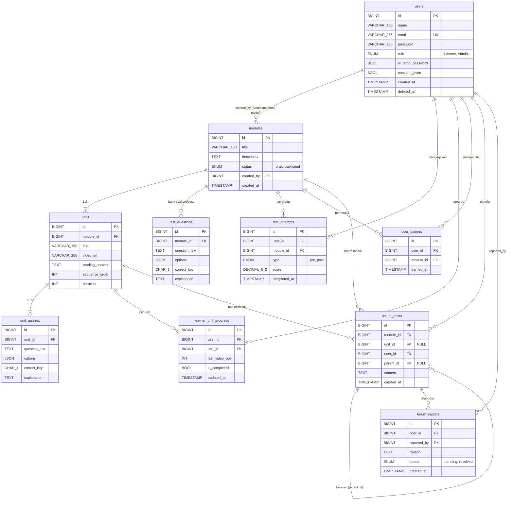
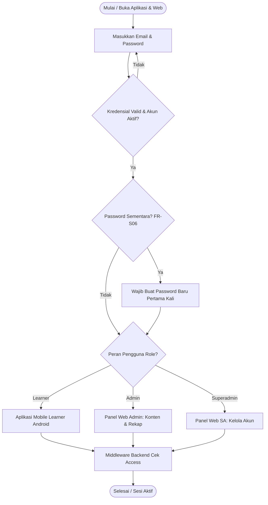
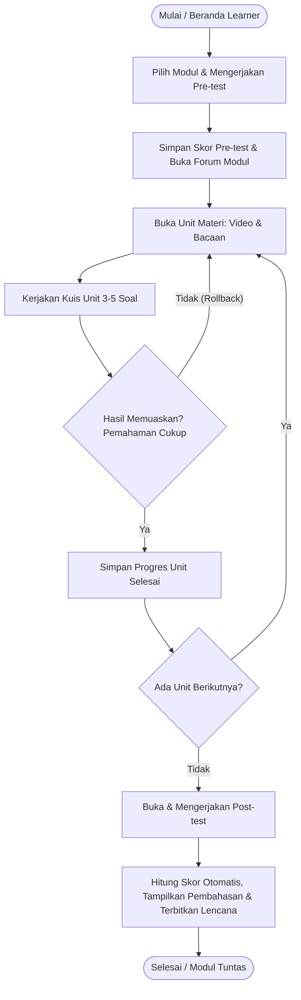
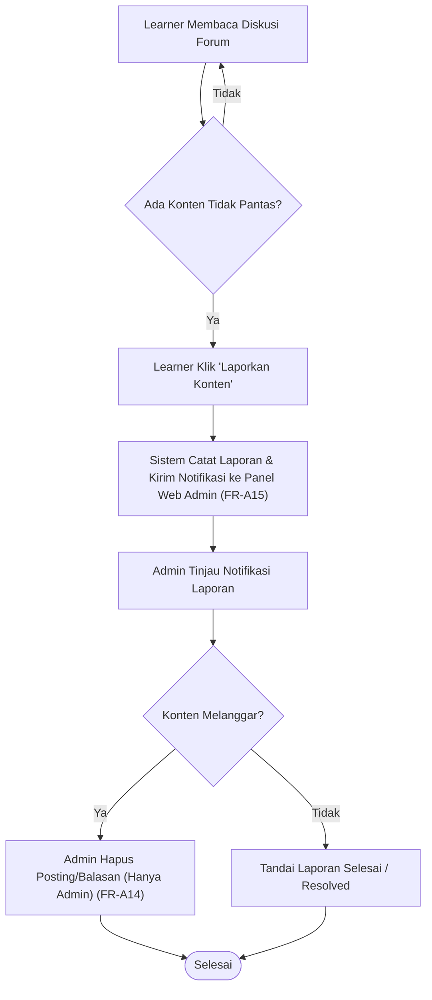
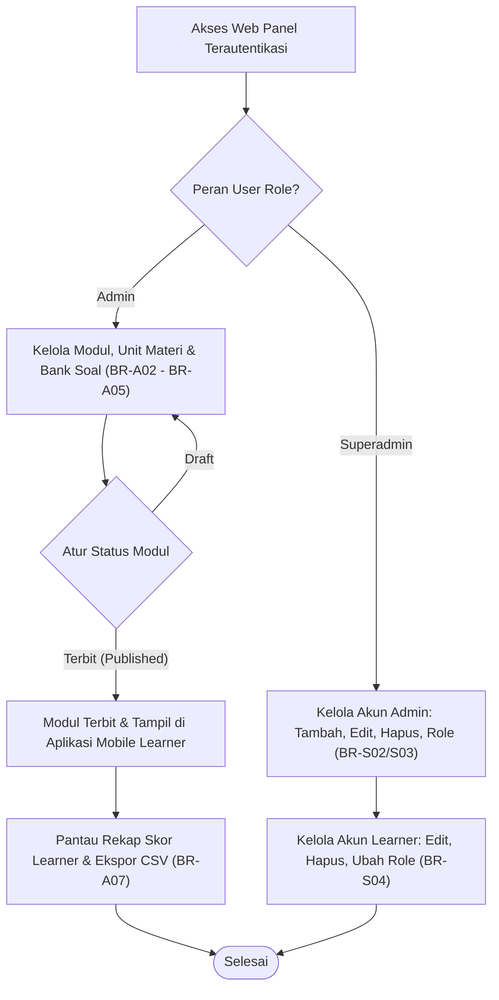

# ERD dan Flowchart — SINAU

ERD memperlihatkan struktur data relasional dan hubungan antar entitas pada platform pembelajaran mandiri Sinau. Platform ini terdiri atas entitas pengguna, modul, unit materi, kuis unit, bank soal tes, riwayat tes, progres belajar, lencana, serta forum diskusi dan laporan moderasi.

> Diagram di bawah memakai sintaks [Mermaid](https://mermaid.js.org/) (ter-render otomatis di GitHub, GitLab, VS Code dengan ekstensi Markdown Mermaid). Ini hasil transkripsi dari Gambar 1–5 pada dokumen asli. Lihat juga PRD bagian 7.4 untuk catatan kesenjangan ERD.

## 1. Entity Relationship Diagram (Gambar 1)

Keterangan: PK = Primary Key; FK = Foreign Key; UK = Unique Key. Satu baris `users` mewakili Learner, Admin, atau Superadmin. Batas kuis unit ditetapkan 3–5 soal per unit.

### 1.1 Penjelasan ERD

| Tabel | Fungsi dan Hubungan |
|---|---|
| `users` | Menyimpan seluruh data akun pengguna (Learner, Admin, Superadmin). Email unik. Atribut `is_temp_password` digunakan untuk memaksa Admin mengganti password saat login pertama (FR-S06). Atribut `consent_given` mencatat persetujuan data awal Learner (BR-L02). |
| `modules` | Menyimpan data modul pembelajaran (misal: Supply Chain Management, Product Identity). Dibuat oleh Admin (`created_by`). Memiliki status draft atau published agar modul yang belum siap tidak tampil di aplikasi mobile. |
| `units` | Menyimpan unit materi per modul yang disusun secara berurutan (`sequence_order`). Berisi tautan video pendek, durasi, dan bacaan ringkas. Setiap unit terikat pada tepat satu modul. |
| `unit_quizzes` | Bank soal kuis atau studi kasus khusus tiap unit. Terikat pada `unit_id`. Setiap unit wajib memiliki 3 sampai 5 soal pilihan ganda beserta kunci dan pembahasan. |
| `test_questions` | Bank soal untuk Pre-test dan Post-test yang terikat pada `module_id`. Berisi pertanyaan, pilihan jawaban, kunci, dan pembahasan yang diacak saat tes berlangsung. |
| `test_attempts` | Menyimpan riwayat dan skor pengerjaan Pre-test dan Post-test oleh Learner. Memulai pre-test membuka akses ke forum modul (lihat PRD 7.4 no. 9: seragamkan menjadi "setelah pre-test selesai"). Skor otomatis dihitung dan disimpan per pengerjaan. |
| `learner_unit_progress` | Mencatat progres posisi terakhir pemutaran video (`last_video_pos`) dan status penyelesaian unit (`is_completed`) per Learner untuk mendukung fitur kelanjutan belajar dari beranda. |
| `user_badges` | Menyimpan lencana personal yang diperoleh Learner setelah menyelesaikan seluruh unit dan Post-test modul. Tidak ada peringkat antar pengguna. |
| `forum_posts` | Menyimpan topik diskusi dan balasan di forum per modul. Dapat dikaitkan ke unit tertentu (opsional). Atribut `parent_id` mendukung struktur balasan bertingkat (self-referential). |
| `forum_reports` | Mencatat laporan konten tidak pantas yang dikirim Learner. Laporan diteruskan ke panel web Admin sebagai notifikasi untuk ditindaklanjuti. |

### 1.2 Kardinalitas dan Aturan Integritas

- `users` ke `modules`: 1 : 0..N (Admin dapat membuat banyak modul).
- `modules` ke `units`: 1 : 1..N (satu modul terdiri atas satu atau lebih unit berurutan).
- `units` ke `unit_quizzes`: 1 : 3..5 (setiap unit wajib memiliki 3 hingga 5 soal kuis/studi kasus).
- `modules` ke `forum_posts`: 1 : 0..N (forum dibuka per modul setelah Learner menyelesaikan pre-test).
- `forum_posts` ke `forum_reports`: 1 : 0..N (setiap postingan forum dapat dilaporkan oleh beberapa Learner).
- **Hak akses data:** skor pada `test_attempts` hanya dapat diakses oleh Learner pemilik data dan Admin (Superadmin ditolak middleware).

---

## 2. Flowchart

### 2.1 Login dan Pembatasan Hak Akses (Gambar 2)

**Tujuan:** memastikan autentikasi pengguna berjalan aman, menangani kewajiban penggantian password sementara, serta membatasi hak akses sesuai role pengguna melalui middleware backend.

Urutan proses:

1. Pengguna membuka aplikasi Android (Learner) atau Panel Web (Admin / Superadmin) lalu menginput kredensial.
2. Sistem memverifikasi email dan password terenkripsi. Jika gagal, pengguna dikembalikan ke formulir login.
3. Sistem memeriksa atribut `is_temp_password`. Jika bernilai true (pada Admin yang dibuat oleh Superadmin), pengguna diwajibkan membuat password baru sebelum dapat mengakses panel.
4. Pengguna yang lolos autentikasi diarahkan ke antarmuka sesuai role:
   - **Learner:** Dashboard Mobile Android.
   - **Admin:** Panel Web Pengelolaan Konten, Soal, Rekap Hasil, dan Forum.
   - **Superadmin:** Panel Web Pengelolaan Akun Admin dan Learner.
5. **Middleware Backend (FR-S05 / FR-SA07):** setiap permintaan API atau rute divalidasi. Jika Admin mencoba mengakses rute Superadmin (atau sebaliknya), middleware menolak akses secara mutlak.

### 2.2 Alur Belajar Learner — Mobile Android (Gambar 3)

**Tujuan:** mengatur urutan belajar mandiri yang fleksibel namun terstruktur bagi staf/pelaku UMKM di sela jam kerja.

Urutan proses:

1. Learner memilih modul pada aplikasi Android dan diwajibkan mengerjakan Pre-test sebagai pengukur awal pengetahuan.
2. Setelah pre-test selesai, forum diskusi modul otomatis terbuka. Learner kemudian mempelajari unit demi unit (video singkat & bacaan ringkas).
3. Di setiap akhir unit, Learner mengerjakan Kuis Unit (3–5 soal).
4. **Mekanisme Rollback (BR-L13 / BR-L09):** jika hasil kuis kurang memuaskan, Learner dapat kembali (rollback) mempelajari ulang materi unit tanpa mengunci unit berikutnya. Skor kuis unit hanya sebagai sarana latihan dan tidak mempengaruhi skor tes akhir.
5. Setelah seluruh unit dalam modul diselesaikan, Post-test terbuka untuk dikerjakan.
6. Sistem menghitung skor post-test secara otomatis, menampilkan pembahasan singkat tiap soal, memperbarui grafik perbandingan pre vs post, serta menerbitkan Lencana Personal.

### 2.3 Moderasi Forum Diskusi (Gambar 4)

**Tujuan:** memastikan iklim diskusi di forum tetap sehat dan relevan melalui mekanisme pelaporan oleh Learner dan moderasi eksklusif oleh Admin (Pengajar).

Urutan proses:

1. **Pelaporan oleh Learner (FR-L35):** saat membaca forum diskusi modul, Learner yang menemui komentar/topik yang tidak pantas dapat menekan tombol "Laporkan Konten". Learner tidak memiliki hak menghapus konten (termasuk miliknya sendiri).
2. **Notifikasi Admin (FR-A15):** sistem mencatat laporan ke tabel `forum_reports` dan secara otomatis memunculkan notifikasi pada Panel Web Admin. Konten tetap tampil di forum sampai tindakan diambil.
3. **Evaluasi Admin (FR-A13 / FR-A14):** Admin membuka panel web, meninjau rincian isi postingan beserta alasan pelaporan.
4. **Tindakan moderasi:**
   - Jika melanggar: Admin menghapus postingan/balasan tersebut dari sistem. Hanya Admin yang memiliki kemampuan menghapus konten forum.
   - Jika wajar/tidak melanggar: Admin menandai laporan berstatus Resolved tanpa menghapus konten.

### 2.4 Pengelolaan Konten & Pengelolaan Akun (Gambar 5)

**Tujuan:** memisahkan tanggung jawab operasional pembelajaran (Admin) dan administrasi akun pengguna (Superadmin) pada Panel Web Sinau.

Urutan proses:

1. **Alur Admin (Pengajar):**
   - Admin menyusun modul, unit materi (video & bacaan), bank soal pre/post test, serta kuis unit (3–5 soal). Modul yang telah lengkap diubah statusnya dari Draft menjadi Published agar dapat diakses oleh Learner di Android.
   - Admin memantau progres dan rekapitulasi nilai seluruh Learner serta mengekspor data ke format CSV.
2. **Alur Superadmin:**
   - Superadmin mendaftarkan akun Admin baru. Sistem secara otomatis membuat password sementara yang wajib diganti Admin saat login pertama.
   - Superadmin mengelola akun Learner (edit data, hapus akun, atau ubah role).
   - **Pemusatan wewenang (BR-S05):** Superadmin ditolak oleh middleware jika mencoba mengakses fungsi Admin seperti menambah modul/soal atau melihat rekap skor.
